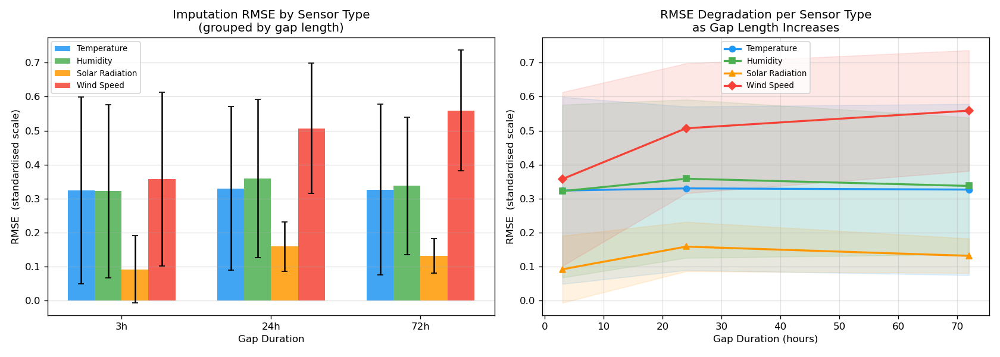
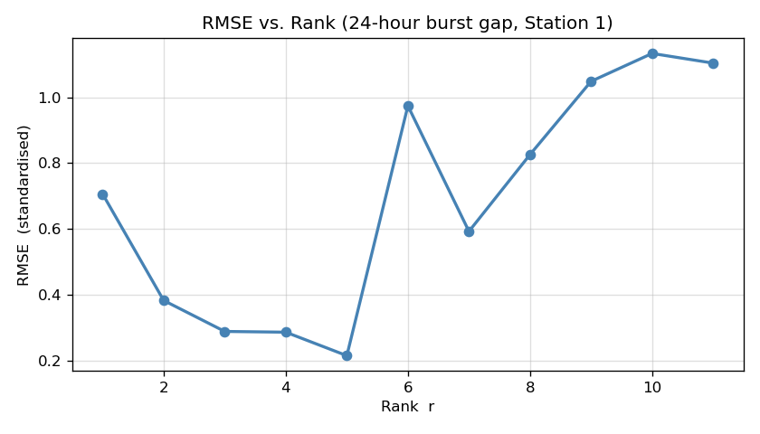

# Missing-Data Imputation for Agricultural Sensor Networks with SVD

Fills gaps in weather-station data by treating three nearby stations as one matrix and completing it with an iterative low-rank method. The singular value decomposition is implemented from scratch instead of calling a library routine.

Individual term project for BBF202E (Numerical Methods), Istanbul Technical University, Spring 2026.

## What it does

- Merges three station files into one 28,310-row, 12-column matrix (temperature, humidity, solar radiation and wind speed for each station).
- Computes the SVD with a custom solver: power method with deflation. The result is checked for orthogonality (largest off-diagonal error below 3 × 10⁻⁵).
- Fills missing values with iterative singular value thresholding: project onto the top *r* components, overwrite only the missing entries, repeat until the change is below 10⁻⁴.
- Stress-tests the method by hiding known values and measuring how well they are recovered.

## Results

Error is RMSE on standardised data, rank 4, with values hidden at Station 1.

| Scenario | Overall RMSE |
| --- | --- |
| Random missing values | 0.371 |
| 24-hour outage | 0.287 |
| 72-hour blackout | 0.375 |

- **Rank 4 is the best choice.** Error falls from 0.706 at rank 1 to 0.287 at rank 4. From rank 5 upward the iteration stops converging.
- **Long outages are recoverable.** Error levels off after about 24 hours and stays stable for gaps up to 120 hours, because the other two stations keep supplying information.
- **Solar radiation is easiest to reconstruct** (RMSE 0.09 to 0.16) **and wind speed is hardest** (0.36 to 0.56), since wind is too irregular for a low-rank model.

## Files

| Path | Contents |
| --- | --- |
| `svd_imputation.ipynb` | Full pipeline: loading, custom SVD, imputation, stress tests, plots |
| `report/report.pdf` | Project report in IEEE format |
| `figures/` | Plots produced by the notebook |

## Running it

The notebook needs Python 3 with `numpy`, `pandas` and `matplotlib`.

The station data was provided by the course and is not included here. To run the notebook, place `station1.csv`, `station2.csv` and `station3.csv` next to it. Each file needs a `zaman_olcum` timestamp column and the columns `sicaklik_2m_mean`, `nispi_nem_2m_mean`, `gunes_radyasyon` and `ruzgar_hizi`.

## Author

Atillahan Gözütok
